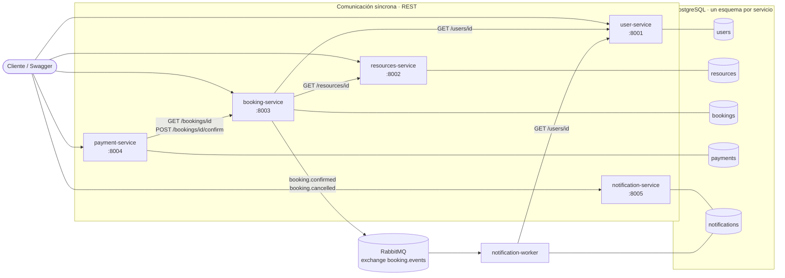
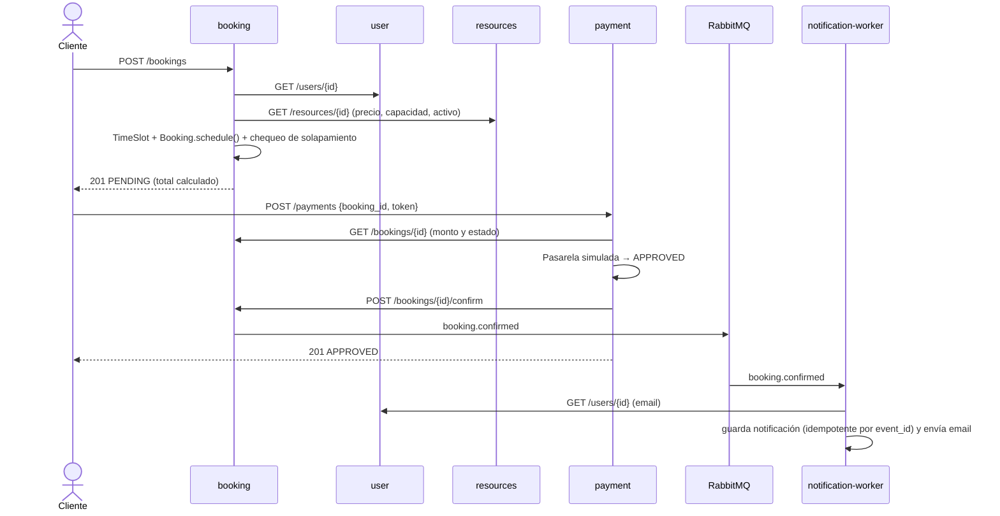
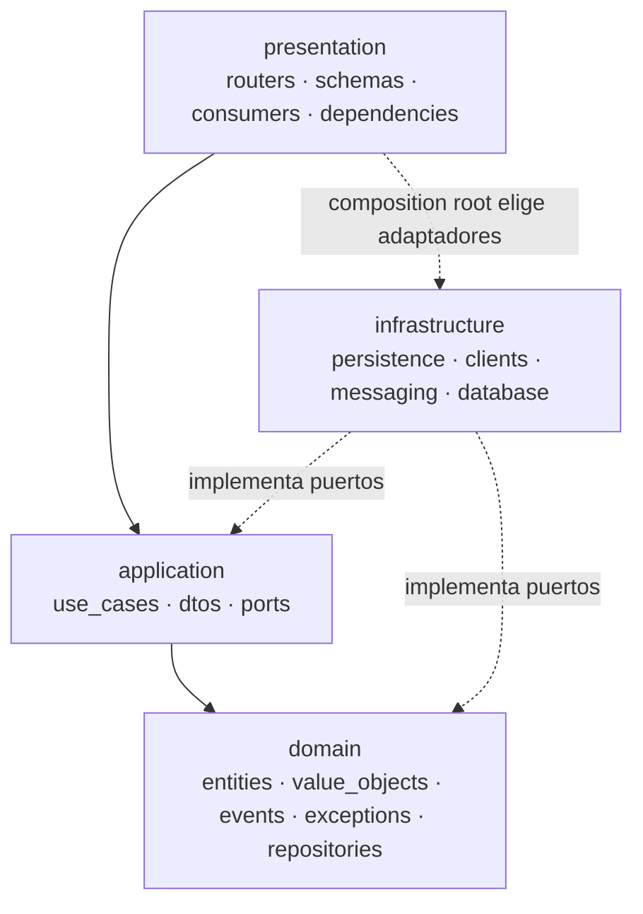

# Arquitectura

## 1. Arquitectura del sistema (microservicios)



### Por qué microservicios aquí

| Servicio | Responsabilidad única | Por qué está separado |
|---|---|---|
| user-service | Identidad y perfiles | Lo consultan todos; cambia poco |
| resources-service | Catálogo de recursos, precio, disponibilidad (activo/inactivo) | Lo administra otro actor (operaciones) |
| booking-service | Reglas de reserva, conflictos, estados | **Núcleo del dominio**; es el que más evoluciona |
| payment-service | Pagos simulados e integridad | Requisitos de seguridad y auditoría distintos |
| notification-service | Entrega de mensajes | Debe poder fallar sin tumbar las reservas (asíncrono) |

No se creó un servicio por tabla: `TimeSlot` y los estados viven dentro de booking.

### Propiedad de datos

- Cada servicio **solo lee y escribe su esquema**. Nadie consulta la base de otro.
- Las referencias entre servicios son **ids sin foreign key** (`user_id`, `resource_id`, `booking_id`).
- **No se comparten modelos ORM**: cada servicio tiene sus propios `models/` y `entities/`.
- Lo que un servicio necesita de otro lo obtiene por **contrato** (ver `contracts.md`) y lo
  representa con su propio DTO (`ResourceSnapshot`, `BookingSnapshot`, `UserContact`).

## 2. Flujo principal



## 3. Arquitectura interna (Clean Architecture, igual en los 5 servicios)



**Regla de dependencias**: las flechas apuntan al dominio. `domain/` no importa
FastAPI, SQLModel, httpx ni pika (se puede verificar con `grep`).

| Capa | Contiene | Ejemplo en booking-service |
|---|---|---|
| domain | Entidades con invariantes, value objects, eventos, excepciones, puertos de repositorio | `Booking.confirm()`, `TimeSlot.overlaps()`, `BookingConfirmed` |
| application | Casos de uso que orquestan, DTOs de entrada, puertos hacia el exterior | `CreateBooking`, `CreateBookingCommand`, `ResourceGateway` |
| infrastructure | Implementaciones concretas | `SQLModelBookingRepository`, `HttpResourceGateway`, `RabbitMQEventPublisher` |
| presentation | Adaptadores de entrada | `booking_router.py`, `booking_schemas.py`, `dependencies.py` |

## 4. La regla clave: evitar conflictos de disponibilidad

Defensa en dos niveles en booking-service:

1. **Dominio / aplicación**: `CreateBooking` busca reservas activas que se solapen y
   lanza `BookingConflictError` (409) con un mensaje claro.
2. **Base de datos**: restricción de exclusión, la única garantía real ante peticiones concurrentes:

```sql
EXCLUDE USING gist (
    resource_id WITH =,
    tstzrange(start_at, end_at, '[)') WITH &&
) WHERE (status <> 'CANCELLED')
```

El repositorio traduce el error `23P01` de Postgres al mismo `BookingConflictError`,
así la capa de presentación no se entera de qué nivel lo detectó.

Mismo patrón en payment-service para "un solo pago aprobado por reserva"
(índice único parcial) y en notification-service para "un evento, una notificación"
(`event_id` único).

## 5. Capacidad de evolución

| Cambio futuro | Qué se toca | Qué NO se toca |
|---|---|---|
| Pasarela real (Wompi/Stripe) | Nuevo adaptador `PaymentProcessor` | Dominio y casos de uso de pagos |
| Emails reales (SMTP/SES) | Nuevo `NotificationSender` | Worker, plantillas y casos de uso |
| Payment confirma por evento en vez de REST | Nuevo adaptador en booking/payment | Entidad `Booking` |
| Outbox para publicar eventos de forma confiable | Infraestructura de booking | Casos de uso (siguen usando `EventPublisher`) |
| Base separada por servicio | `DATABASE_URL` de cada servicio | Código |
